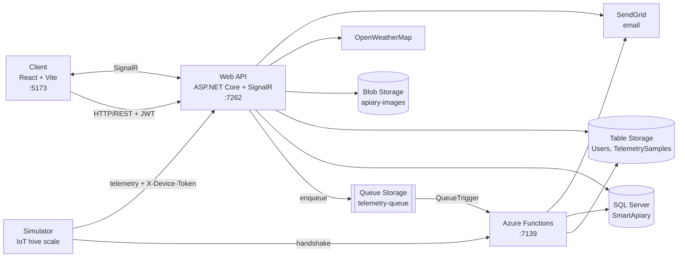

# Smart Apiary

**English** | [Srpski](README.sr.md)

A cloud platform that connects beekeepers and farmers. Beekeepers manage their apiaries and hives on a map, keep a hive inspection diary and follow live data from IoT hive scales (weight, temperature, humidity, battery). Farmers manage their plots and crops and announce pesticide spraying, and every beekeeper with an apiary within 5 km is notified automatically. Telemetry is processed asynchronously through Azure Queue Storage and Azure Functions, pushed to the browser in real time with SignalR, and alerts for a sudden weight drop (possible theft or an overturned hive) or a low battery are sent by email.

## Table of Contents

- [Features](#features)
- [Tech Stack](#tech-stack)
- [Architecture](#architecture)
- [Prerequisites](#prerequisites)
- [Installation](#installation)
- [Usage](#usage)
- [Configuration](#configuration)
- [Team](#team)
- [Contact](#contact)

## Features

**Accounts and roles**

- **Roles** – `Admin`, `Beekeeper` and `Farmer`
- **Accounts created by the administrator** – the admin registers a user, the user receives an activation link by email (valid for 24 hours) and sets their own password
- **Login with JWT** – the token is valid for 60 minutes; passwords are stored hashed (bcrypt) and must have at least 8 characters, one uppercase letter and one number
- **Forgotten password** – a reset link valid for 1 hour
- **User management** – the admin can search, suspend, reactivate and delete users; a suspended user cannot log in

**Beekeeper**

- **Apiaries on a map** – the location is picked on an OpenStreetMap map (Leaflet); an apiary can have a photo, from which a 150×150 thumbnail is created (JPEG, PNG or WebP, up to 10 MB)
- **Hives** – label, hive type (LR, DB, Poloshka, Dadant, other), box color, queen age and notes
- **Hive inspection diary** – date, bottom board color, honey frames, honey (kg), brood frames, queen present, notes
- **IoT hive scale** – a device with a serial number in the format `SA-YYYY-XXXXX` is registered on a hive and paired through a handshake, after which it sends measurements with its own access token
- **Live telemetry** – weight, temperature, humidity and battery charts update without refreshing the page (SignalR)
- **Daily nectar intake** – the difference between the weight around 20:00 and around 08:00 for each day
- **Alerts** – a weight drop of 10 kg or more, or a battery below 15%, shows an alert in the browser and sends an email
- **Spraying warnings** – the apiary page shows announced sprayings within 5 km, and the map shows nearby crops with an icon for each crop type

**Farmer**

- **Plots on a map** – name and location
- **Crops** – crop type (sunflower, rapeseed, lavender, clover, acacia, corn, wheat, other) with the blooming period
- **Spraying schedule** – date, duration in hours and the preparation used; a spraying can be rescheduled or cancelled
- **Automatic notification** – all beekeepers whose apiary is within 5 km of the plot receive an email when a spraying is scheduled, rescheduled or cancelled (spatial query with SQL Server `GEOGRAPHY`)
- **Weather check** – if the forecast for the scheduled time (OpenWeatherMap) shows wind above 5 m/s or rain, the spraying is rejected
- **Automatic completion** – a timer function marks a spraying as `Completed` once its time plus duration has passed
- **Spraying history** – filters by plot, period and status, with an export to PDF

## Tech Stack

| Layer              | Technology                                                                      |
| ------------------ | ------------------------------------------------------------------------------- |
| Frontend           | React 19 (Vite), TypeScript, Tailwind CSS, React Router, Leaflet, SignalR client |
| Web API            | ASP.NET Core 8 Web API, SignalR, Swagger                                         |
| Background work    | Azure Functions v4 (.NET 8 isolated worker) – HTTP, Queue and Timer triggers     |
| Application layer  | MediatR (CQRS), FluentValidation, Result pattern, domain events                  |
| Relational data    | SQL Server (LocalDB), ADO.NET (`Microsoft.Data.SqlClient`), `GEOGRAPHY` type     |
| Cloud storage      | Azure Table Storage, Blob Storage and Queue Storage (Azurite locally)            |
| Device simulator   | .NET 8 console application                                                       |
| Other              | SendGrid (email), QuestPDF (PDF), ImageSharp (thumbnails), OpenWeatherMap API    |
| Authentication     | JWT, passwords hashed with bcrypt, a separate access token for each device      |

## Architecture

The backend follows **Clean Architecture**: `Domain` (models, rules, domain events) → `Application` (commands and queries with MediatR, validators) → `Infrastructure` (SQL, Azure Storage, email, PDF, weather). The **Web API** and the **Azure Functions** are two separate hosts that use the same `Application` and `Infrastructure` layers.

| Component      | Folder                              | Responsibility                                                                                              | Port               |
| -------------- | ----------------------------------- | ----------------------------------------------------------------------------------------------------------- | ------------------ |
| Client         | `SmartApiary.UI/`                   | User interface for all three roles                                                                          | 5173               |
| Web API        | `SmartApiary/SmartApiary.WebApi/`   | REST API for the client, receives telemetry from devices, SignalR hub (`/notification-hub`)                  | 7262 (https), 5062 |
| Functions      | `SmartApiary/SmartApiary.Functions/`| Device handshake, processing the telemetry queue and alert emails, timer for completing sprayings           | 7139               |
| Simulator      | `Simulator/`                        | Simulates an IoT hive scale: pairs with the system and sends a measurement every 5 seconds                   | —                  |
| Azurite        | —                                   | Local emulator for Table, Blob and Queue Storage                                                            | 10000–10002        |
| SQL Server     | `SmartApiary/SQLQuery1.sql`         | Apiaries, hives, devices, inspections, plots, crops, sprayings                                              | LocalDB            |

### System architecture



### Telemetry flow

1. The beekeeper registers a device with its serial number on a hive → the device is saved with status `Unpaired`.
2. The device (simulator) sends its UUID and serial number to the **handshake** function → it receives an access token, and the status becomes `Paired`.
3. Every 5 seconds the device sends a measurement to the Web API with the `X-Device-Token` header.
4. The Web API puts the measurement into `telemetry-queue`, immediately sends it to the beekeeper's browser through SignalR and, if the weight dropped by 10 kg or more or the battery fell below 15%, sends an alert to the browser.
5. `TelemetryQueueFunction` takes the message from the queue, saves the measurement to Table Storage and sends the alert by email to the owner of the apiary.

### Spraying lifecycle

1. The **farmer** schedules a spraying on a plot → the weather forecast for that time is checked.
2. The spraying is saved with status `Scheduled` → beekeepers with an apiary within 5 km receive an email, and the number of notified beekeepers is saved.
3. The spraying can be **rescheduled** or **cancelled** (`Cancelled`) → the nearby beekeepers are notified again.
4. When the scheduled time plus duration has passed, `SprayingCompletionTimer` (runs every 30 seconds for the demo) sets the status to `Completed`.

### Data model

**SQL Server (`SmartApiary`)**, created with `SmartApiary/SQLQuery1.sql`:

| Table               | Main columns                                                                                                   |
| ------------------- | -------------------------------------------------------------------------------------------------------------- |
| `Apiaries`          | `Id`, `OwnerId`, `Name`, `Latitude`, `Longitude`, `Location` (`GEOGRAPHY`, spatial index), `Description`, `ImageUrl`, `ThumbnailUrl` |
| `Hives`             | `Id`, `ApiaryId` (FK, cascade), `Label`, `Type`, `BoxColor`, `QueenAge`, `Note`                                 |
| `Devices`           | `Id`, `HiveId` (FK, cascade), `SerialNumber` (unique), `DeviceUuid`, `AccessToken`, `Status`, `RegisteredAt`, `PairedAt` |
| `HiveInspections`   | `Id`, `HiveId` (FK, cascade), `InspectionDate`, `BottomBoardColor`, `HoneyFrames`, `HoneyKg`, `BroodFrames`, `QueenPresent`, `Notes` |
| `Plots`             | `Id`, `OwnerId`, `Name`, `Latitude`, `Longitude`, `Location` (`GEOGRAPHY`, spatial index)                        |
| `Cultures`          | `Id`, `PlotId` (FK, cascade), `Type`, `BloomingStart`, `BloomingEnd`, `AdditionalInfo`                          |
| `SprayingSchedules` | `Id`, `PlotId` (FK, cascade), `ScheduledAt`, `DurationHours`, `Preparation`, `Status`, `NotifiedBeekeeperCount` |

**Azure Table Storage**:

| Table              | PartitionKey | RowKey                                         | Content                                                         |
| ------------------ | ------------ | ---------------------------------------------- | --------------------------------------------------------------- |
| `Users`            | `Users`      | email (lowercase)                              | name, role, status, password hash, activation and reset tokens  |
| `TelemetrySamples` | hive id      | `DateTime.MaxValue.Ticks - RecordedAt.Ticks`   | weight, temperature, humidity, battery, device id, time         |

The RowKey of a measurement is an inverted timestamp, so the newest measurement of a hive is always the first row in its partition.

**Azure Blob Storage**, container `apiary-images`: `originals/apiary-{id}.jpg` and `thumbnails/apiary-{id}.jpg`.

**Azure Queue Storage**, queue `telemetry-queue`, one message per measurement:

```json
{
  "deviceId": "guid",
  "hiveId": "guid",
  "weightKg": 42.15,
  "humidity": 61.3,
  "temperature": 34.8,
  "batteryPercentage": 87,
  "recordedAt": "2026-10-16T10:15:00Z"
}
```

## Prerequisites

Make sure you have the following installed:

- **.NET 8 SDK**
- **Node.js** 20.19+ or 22.12+ and **npm**
- **Azure Functions Core Tools v4**
- **Azurite** (the latest version, installed with `npm install -g azurite@latest`)
- **SQL Server LocalDB** (installed with Visual Studio) and optionally **sqlcmd**
- **Azure Storage Explorer** – for creating the tables and the first administrator
- **Visual Studio 2022** – optional, everything can also be run from the terminal
- **Git**
- A **SendGrid API key** and an **OpenWeatherMap API key** – optional; without them the application works, only the emails are not sent and the weather check is skipped

## Installation

All commands below are for **Windows PowerShell** and are run from the root folder of the project unless stated otherwise.

### 1. Clone the repository

```bash
git clone https://github.com/miroslavdispiter/smart-apiary-cloud.git
cd smart-apiary-cloud
```

### 2. Create the SQL database

The script `SmartApiary/SQLQuery1.sql` creates the database `SmartApiary` and all its tables. It can be run more than once, because it creates only what does not exist yet.

**Option A – terminal:**

```powershell
sqllocaldb start mssqllocaldb
sqlcmd -S "(localdb)\mssqllocaldb" -i SmartApiary\SQLQuery1.sql
```

**Option B – Visual Studio:** **View → SQL Server Object Explorer → (localdb)\MSSQLLocalDB**, then right-click → **New Query**, paste the script and run it.

### 3. Start Azurite

In a **new terminal**, which stays open:

```powershell
npm install -g azurite@latest
azurite --location C:\azurite
```

Azurite now listens on ports `10000` (Blob), `10001` (Queue) and `10002` (Table), and keeps its data in `C:\azurite`.

> If the application reports `The API version ... is not supported by Azurite`, update Azurite or start it with `--skipApiVersionCheck`.

### 4. Create the storage tables

The queue `telemetry-queue` and the container `apiary-images` are created automatically, but the **tables have to be created manually**. In Azure Storage Explorer open **Emulator & Attached → Storage Accounts → (Emulator - Default Ports) → Tables**, right-click **Tables → Create Table** and create:

- `Users`
- `TelemetrySamples`

### 5. Fill in the configuration

Set your own values in `SmartApiary/SmartApiary.WebApi/appsettings.json` and `SmartApiary/SmartApiary.Functions/local.settings.json` as described in the [Configuration](#configuration) section.

### 6. Trust the development HTTPS certificate

```powershell
dotnet dev-certs https --trust
```

### 7. Run the Azure Functions

In a **new terminal**:

```powershell
cd SmartApiary\SmartApiary.Functions
func start --port 7139
```

The console lists three functions: `DeviceHandshake`, `TelemetryQueueFunction` and `SprayingCompletionTimer`. Leave this terminal open.

### 8. Run the Web API

In a **new terminal**:

```powershell
cd SmartApiary\SmartApiary.WebApi
dotnet run --launch-profile https
```

The API runs on `https://localhost:7262` and Swagger is available at `https://localhost:7262/swagger`.

> The `https` profile is required, because the client calls `https://localhost:7262`.

**Visual Studio instead of steps 7 and 8:** open `cloud_tim19.sln`, right-click the solution → **Configure Startup Projects → Multiple startup projects**, set `SmartApiary.Functions` and `SmartApiary.WebApi` to **Start** (the Web API with the **https** debug target) and press **Ctrl+F5**. Running without the debugger uses much less memory.

### 9. Run the frontend

In a **new terminal**:

```powershell
cd SmartApiary.UI
npm install
npm run dev
```

The application is available at `http://localhost:5173`.

### 10. Create the first administrator

Accounts are created only by an administrator, so the first one is added directly to the `Users` table. In Azure Storage Explorer open the `Users` table, click **+ Add** and enter:

| Property          | Type     | Value                                   |
| ----------------- | -------- | --------------------------------------- |
| `PartitionKey`    | String   | `Users`                                 |
| `RowKey`          | String   | `admin@example.com` (lowercase)         |
| `Id`              | String   | any GUID                                |
| `FirstName`       | String   | your first name                         |
| `LastName`        | String   | your last name                          |
| `Role`            | String   | `Admin`                                 |
| `Status`          | String   | `Pending`                               |
| `ActivationToken` | String   | `admin-setup`                           |
| `CreatedAt`       | DateTime | today's date                            |

Then open `http://localhost:5173/activate?token=admin-setup`, set a password and log in.

### 11. Run the device simulator

The simulator needs a device registered in the application first (see [Usage](#usage)). In a **new terminal**:

```powershell
cd Simulator
dotnet run
```

Enter the serial number of the registered device. The simulator pairs with the system and sends a measurement every 5 seconds until its simulated battery runs out.

## Usage

Once Azurite, the Functions, the Web API and the frontend are running, open `http://localhost:5173`.

> To follow beekeepers and farmers at the same time, log in with different users in **different browsers** (or a normal and an incognito window), because one browser keeps only one logged-in user.

> Without a SendGrid key the activation and reset emails are not sent. The token can then be copied from the `ActivationToken` or `PasswordResetToken` column of the `Users` table and opened as `http://localhost:5173/activate?token=...` or `http://localhost:5173/reset-password?token=...`.

**Administrator**

1. Open **Users**, click **+ Register User** and register a user with the role `Beekeeper` or `Farmer`.
2. The user receives an activation link by email and sets a password.
3. Search users, **suspend** or **reactivate** them, or delete them.

**Beekeeper**

1. In **My Apiaries** click **Add Apiary**, enter the name and description, click on the map to set the location and optionally upload a photo.
2. Open the apiary and add hives with **+ Add Hive**.
3. On a hive click **Dnevnik** to open the inspection diary and **Add Inspection** to record an inspection.
4. On a hive click **Register Device** and enter a serial number, for example `SA-2026-AB123`, then start the simulator with the same serial number.
5. Click **Open Telemetry & Alerts** – the charts update live, and alerts appear on a sudden weight drop or a low battery.
6. If a farmer schedules a spraying within 5 km, the apiary page shows **Upcoming spraying near your apiary!** and the map shows the nearby crops.

**Farmer**

1. In **My Plots** click **Add Plot** and set the location on the map.
2. Open the plot and click **+ Set Culture** to enter the crop and its blooming period.
3. Click **+ Schedule** to schedule a spraying (date and time, duration, preparation). The response shows how many beekeepers were notified.
4. **Reschedule** or **Cancel** a scheduled spraying.
5. Open **Spraying History**, filter by plot, period or status and click **Export PDF**.

## Configuration

> **Note:**
> - Replace `JwtOptions:Secret` with your own random string of at least 32 characters, and use the same value in the Web API and the Functions.
> - Without `EmailOptions:ApiKey` the application works, only the emails are not sent.
> - Without a valid `WeatherOptions:ApiKey` the weather check is skipped and every spraying is allowed.
> - `UseDevelopmentStorage=true` points to Azurite. For Azure, replace it with the connection string of a Storage account.
> - Do not commit real API keys. For local development prefer `dotnet user-secrets` for the Web API.

### Web API

`SmartApiary/SmartApiary.WebApi/appsettings.json`

```json
{
  "AzureTableOptions": {
    "ConnectionString": "UseDevelopmentStorage=true",
    "UsersTable": "Users",
    "TelemetrySamplesTable": "TelemetrySamples"
  },
  "AzureQueueOptions": { "ConnectionString": "UseDevelopmentStorage=true" },
  "AzureBlobOptions": { "ConnectionString": "UseDevelopmentStorage=true" },
  "AzureSqlOptions": {
    "ConnectionString": "Server=(localdb)\\mssqllocaldb;Database=SmartApiary;Trusted_Connection=True;"
  },
  "JwtOptions": {
    "Secret": "your-very-strong-secret-key-min-32-characters-long",
    "Issuer": "SmartApiary",
    "Audience": "SmartApiary",
    "ExpirationMinutes": 60
  },
  "EmailOptions": {
    "ApiKey": "your-sendgrid-api-key",
    "SenderEmail": "your-verified-sender@example.com",
    "SenderName": "Smart Apiary"
  },
  "FrontendOptions": { "BaseUrl": "http://localhost:5173" },
  "WebApi": {
    "CorsPolicyName": "_reactAppPolicy",
    "ReactOrigin": "http://localhost:5173",
    "NotificationHubRoute": "/notification-hub"
  },
  "WeatherOptions": { "ApiKey": "your-openweathermap-api-key" }
}
```

### Azure Functions

`SmartApiary/SmartApiary.Functions/local.settings.json`

```json
{
  "IsEncrypted": false,
  "Values": {
    "AzureWebJobsStorage": "UseDevelopmentStorage=true",
    "FUNCTIONS_WORKER_RUNTIME": "dotnet-isolated",
    "AzureTableOptions:ConnectionString": "UseDevelopmentStorage=true",
    "AzureTableOptions:UsersTable": "Users",
    "AzureTableOptions:TelemetrySamplesTable": "TelemetrySamples",
    "AzureBlobOptions:ConnectionString": "UseDevelopmentStorage=true",
    "AzureQueueOptions:ConnectionString": "UseDevelopmentStorage=true",
    "AzureSqlOptions:ConnectionString": "Server=(localdb)\\mssqllocaldb;Database=SmartApiary;Trusted_Connection=True;Trust Server Certificate=True;",
    "JwtOptions:Secret": "your-very-strong-secret-key-min-32-characters-long",
    "JwtOptions:Issuer": "SmartApiary",
    "JwtOptions:Audience": "SmartApiary",
    "JwtOptions:ExpirationMinutes": "60",
    "EmailOptions:ApiKey": "your-sendgrid-api-key",
    "EmailOptions:SenderEmail": "your-verified-sender@example.com",
    "EmailOptions:SenderName": "Smart Apiary"
  }
}
```

### Frontend and simulator

The addresses are currently set in the code:

| Where                                    | Value                                             |
| ---------------------------------------- | ------------------------------------------------- |
| `SmartApiary.UI/src/api/axiosInstance.ts` | `https://localhost:7262/api`                      |
| `SmartApiary.UI/src/api/telemetry.ts`     | `https://localhost:7262` (SignalR hub)            |
| `Simulator/Program.cs`                    | `http://localhost:7139/api/device/handshake`      |
| `Simulator/Simulator/Simulator.cs`        | `http://localhost:5062/api/devices/telemetry`     |

Alert thresholds (10 kg, 15%) and the notification radius (5 km) are constants in the code.

## Team

Smart Apiary was built as a team project of six students. The commit history shows the work of each member:

| Member                  | Main contribution                                                                                    |
| ----------------------- | ---------------------------------------------------------------------------------------------------- |
| 22MP                    | Project setup (Clean Architecture), users and authentication, email and JWT services                  |
| Nikola Ljaljić          | Apiaries and hives (backend), frontend foundation, map                                               |
| giokovacevic            | IoT devices, handshake function, telemetry queue processing, alerts, simulator                       |
| Luka Milivojević        | Real-time telemetry in the frontend (SignalR)                                                        |
| goraan03                | Plots, crops, spraying schedule, PDF export                                                          |
| **Miroslav Dišpiter**   | Hive inspection diary, spraying warnings within 5 km of an apiary, nearby crops on the map, timer function for completing sprayings |

## Contact

**Miroslav Dišpiter**

- GitHub: [@miroslavdispiter](https://github.com/miroslavdispiter)
- Email: miroslav.dispiter.it@gmail.com
