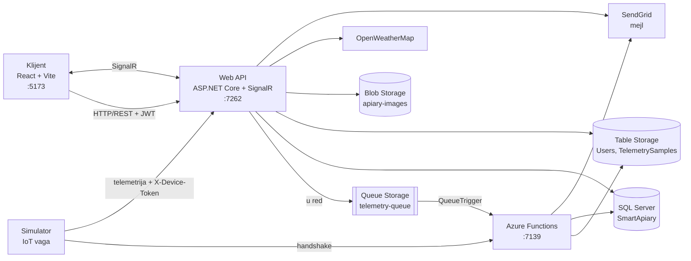

# Smart Apiary

[English](README.md) | **Srpski**

Cloud platforma koja povezuje pčelare i poljoprivrednike. Pčelari vode svoje pčelinjake i košnice na mapi, popunjavaju dnevnik pregleda košnica i prate podatke uživo sa IoT vaga na košnicama (težina, temperatura, vlažnost, baterija). Poljoprivrednici vode parcele i kulture i najavljuju prskanje pesticidima, a svaki pčelar čiji je pčelinjak u krugu od 5 km automatski dobija obaveštenje. Telemetrija se obrađuje asinhrono preko Azure Queue Storage-a i Azure Functions-a, u browser stiže u realnom vremenu preko SignalR-a, a upozorenja za nagli pad težine (moguća krađa ili prevrnuta košnica) ili praznu bateriju šalju se mejlom.

## Sadržaj

- [Funkcionalnosti](#funkcionalnosti)
- [Tehnologije](#tehnologije)
- [Arhitektura](#arhitektura)
- [Preduslovi](#preduslovi)
- [Instalacija](#instalacija)
- [Korišćenje](#korišćenje)
- [Konfiguracija](#konfiguracija)
- [Unapređenja posle projekta](#unapređenja-posle-projekta)
- [Tim](#tim)
- [Kontakt](#kontakt)

## Funkcionalnosti

**Nalozi i uloge**

- **Uloge** – `Admin`, `Beekeeper` (pčelar) i `Farmer` (poljoprivrednik)
- **Naloge pravi administrator** – admin registruje korisnika, korisnik dobija aktivacioni link mejlom (važi 24 sata) i sam postavlja lozinku
- **Prijava preko JWT-a** – token važi 60 minuta; lozinke se čuvaju heširane (bcrypt) i moraju imati najmanje 8 karaktera, jedno veliko slovo i jedan broj
- **Zaboravljena lozinka** – link za reset koji važi 1 sat
- **Upravljanje korisnicima** – admin pretražuje, suspenduje, ponovo aktivira i briše korisnike; suspendovan korisnik ne može da se prijavi

**Pčelar**

- **Pčelinjaci na mapi** – lokacija se bira na OpenStreetMap mapi (Leaflet); pčelinjak može imati fotografiju, od koje se pravi thumbnail 150×150 (JPEG, PNG ili WebP, do 10 MB)
- **Košnice** – oznaka, tip košnice (LR, DB, Pološka, Dadant, ostalo), boja sanduka, starost matice i beleške
- **Dnevnik pregleda košnice** – datum, boja podnjače, broj ramova sa medom, med (kg), ramovi sa leglom, prisustvo matice, beleške
- **IoT vaga za košnicu** – uređaj sa serijskim brojem u formatu `SA-YYYY-XXXXX` registruje se na košnicu i uparuje preko handshake-a, a zatim šalje merenja sa sopstvenim pristupnim tokenom
- **Telemetrija uživo** – grafikoni težine, temperature, vlažnosti i baterije osvežavaju se bez ponovnog učitavanja stranice (SignalR)
- **Dnevni unos nektara** – razlika između težine oko 20:00 i oko 08:00 za svaki dan
- **Upozorenja** – pad težine od 10 kg ili više, ili baterija ispod 15%, prikazuje upozorenje u browser-u i šalje mejl
- **Upozorenja na prskanje** – stranica pčelinjaka prikazuje najavljena prskanja u krugu od 5 km, a mapa prikazuje obližnje kulture sa ikonicom za svaki tip kulture

**Poljoprivrednik**

- **Parcele na mapi** – naziv i lokacija
- **Kulture** – tip kulture (suncokret, uljana repica, lavanda, detelina, bagrem, kukuruz, pšenica, ostalo) sa periodom cvetanja
- **Raspored prskanja** – datum, trajanje u satima i preparat; prskanje može da se pomeri ili otkaže
- **Automatsko obaveštavanje** – svi pčelari čiji je pčelinjak u krugu od 5 km od parcele dobijaju mejl kada se prskanje zakaže, pomeri ili otkaže (prostorni upit sa SQL Server `GEOGRAPHY` tipom)
- **Provera vremena** – ako prognoza za zakazano vreme (OpenWeatherMap) pokazuje vetar jači od 5 m/s ili kišu, prskanje se odbija
- **Automatsko završavanje** – timer funkcija označava prskanje kao `Completed` kada prođe zakazano vreme plus trajanje
- **Istorija prskanja** – filteri po parceli, periodu i statusu, uz izvoz u PDF

## Tehnologije

| Sloj                 | Tehnologija                                                                       |
| -------------------- | --------------------------------------------------------------------------------- |
| Frontend             | React 19 (Vite), TypeScript, Tailwind CSS, React Router, Leaflet, SignalR klijent  |
| Web API              | ASP.NET Core 8 Web API, SignalR, Swagger                                           |
| Pozadinski poslovi   | Azure Functions v4 (.NET 8 isolated worker) – HTTP, Queue i Timer trigeri          |
| Aplikacioni sloj     | MediatR (CQRS), FluentValidation, Result pattern, domenski eventi                  |
| Relacioni podaci     | SQL Server (LocalDB), ADO.NET (`Microsoft.Data.SqlClient`), `GEOGRAPHY` tip        |
| Cloud skladište      | Azure Table Storage, Blob Storage i Queue Storage (lokalno Azurite)               |
| Simulator uređaja    | .NET 8 konzolna aplikacija                                                         |
| Ostalo               | SendGrid (mejl), QuestPDF (PDF), ImageSharp (thumbnail-ovi), OpenWeatherMap API    |
| Autentifikacija      | JWT, lozinke heširane bcrypt-om, poseban pristupni token za svaki uređaj          |

## Arhitektura

Backend prati **Clean Architecture**: `Domain` (modeli, pravila, domenski eventi) → `Application` (komande i upiti preko MediatR-a, validatori) → `Infrastructure` (SQL, Azure Storage, mejl, PDF, vremenska prognoza). **Web API** i **Azure Functions** su dva odvojena hosta koja koriste iste `Application` i `Infrastructure` slojeve.

| Komponenta     | Folder                               | Odgovornost                                                                                                  | Port               |
| -------------- | ------------------------------------ | ------------------------------------------------------------------------------------------------------------ | ------------------ |
| Klijent        | `SmartApiary.UI/`                    | Korisnički interfejs za sve tri uloge                                                                        | 5173               |
| Web API        | `SmartApiary/SmartApiary.WebApi/`    | REST API za klijenta, prijem telemetrije sa uređaja, SignalR hub (`/notification-hub`)                       | 7262 (https), 5062 |
| Functions      | `SmartApiary/SmartApiary.Functions/` | Handshake uređaja, obrada reda sa telemetrijom i mejlovi upozorenja, timer za završavanje prskanja           | 7139               |
| Simulator      | `Simulator/`                         | Simulira IoT vagu za košnicu: uparuje se sa sistemom i šalje merenje na svakih 5 sekundi                     | —                  |
| Azurite        | —                                    | Lokalni emulator za Table, Blob i Queue Storage                                                              | 10000–10002        |
| SQL Server     | `SmartApiary/SQLQuery1.sql`          | Pčelinjaci, košnice, uređaji, pregledi, parcele, kulture, prskanja                                           | LocalDB            |

### Arhitektura sistema



### Tok telemetrije

1. Pčelar registruje uređaj sa serijskim brojem na košnicu → uređaj se čuva sa statusom `Unpaired`.
2. Uređaj (simulator) šalje svoj UUID i serijski broj **handshake** funkciji → dobija pristupni token, a status postaje `Paired`.
3. Na svakih 5 sekundi uređaj šalje merenje Web API-ju sa zaglavljem `X-Device-Token`.
4. Web API stavlja merenje u `telemetry-queue`, odmah ga šalje u browser pčelara preko SignalR-a i, ako je težina pala za 10 kg ili više ili je baterija pala ispod 15%, šalje upozorenje u browser.
5. `TelemetryQueueFunction` preuzima poruku iz reda, upisuje merenje u Table Storage i šalje upozorenje mejlom vlasniku pčelinjaka.

### Životni ciklus prskanja

1. **Poljoprivrednik** zakazuje prskanje na parceli → proverava se vremenska prognoza za taj termin.
2. Prskanje se čuva sa statusom `Scheduled` → pčelari sa pčelinjakom u krugu od 5 km dobijaju mejl, a broj obaveštenih pčelara se čuva.
3. Prskanje može da se **pomeri** ili **otkaže** (`Cancelled`) → obližnji pčelari ponovo dobijaju obaveštenje.
4. Kada prođe zakazano vreme plus trajanje, `SprayingCompletionTimer` (za demo se pokreće na svakih 30 sekundi) postavlja status na `Completed`.

### Model podataka

**SQL Server (`SmartApiary`)**, pravi ga skripta `SmartApiary/SQLQuery1.sql`:

| Tabela              | Glavne kolone                                                                                                  |
| ------------------- | -------------------------------------------------------------------------------------------------------------- |
| `Apiaries`          | `Id`, `OwnerId`, `Name`, `Latitude`, `Longitude`, `Location` (`GEOGRAPHY`, prostorni indeks), `Description`, `ImageUrl`, `ThumbnailUrl` |
| `Hives`             | `Id`, `ApiaryId` (FK, kaskadno), `Label`, `Type`, `BoxColor`, `QueenAge`, `Note`                                |
| `Devices`           | `Id`, `HiveId` (FK, kaskadno), `SerialNumber` (jedinstven), `DeviceUuid`, `AccessToken`, `Status`, `RegisteredAt`, `PairedAt` |
| `HiveInspections`   | `Id`, `HiveId` (FK, kaskadno), `InspectionDate`, `BottomBoardColor`, `HoneyFrames`, `HoneyKg`, `BroodFrames`, `QueenPresent`, `Notes` |
| `Plots`             | `Id`, `OwnerId`, `Name`, `Latitude`, `Longitude`, `Location` (`GEOGRAPHY`, prostorni indeks)                     |
| `Cultures`          | `Id`, `PlotId` (FK, kaskadno), `Type`, `BloomingStart`, `BloomingEnd`, `AdditionalInfo`                         |
| `SprayingSchedules` | `Id`, `PlotId` (FK, kaskadno), `ScheduledAt`, `DurationHours`, `Preparation`, `Status`, `NotifiedBeekeeperCount` |

**Azure Table Storage**:

| Tabela             | PartitionKey | RowKey                                         | Sadržaj                                                         |
| ------------------ | ------------ | ---------------------------------------------- | --------------------------------------------------------------- |
| `Users`            | `Users`      | email (malim slovima)                          | ime, uloga, status, heš lozinke, tokeni za aktivaciju i reset   |
| `TelemetrySamples` | id košnice   | `DateTime.MaxValue.Ticks - RecordedAt.Ticks`   | težina, temperatura, vlažnost, baterija, id uređaja, vreme      |

RowKey merenja je obrnut vremenski žig, pa je najnovije merenje košnice uvek prvi red u njenoj particiji.

**Azure Blob Storage**, kontejner `apiary-images`: `originals/apiary-{id}.jpg` i `thumbnails/apiary-{id}.jpg`.

**Azure Queue Storage**, red `telemetry-queue`, jedna poruka po merenju:

```json
{
  "deviceId": "guid",
  "hiveId": "guid",
  "weightKg": 42.15,
  "humidity": 61.3,
  "temperature": 34.8,
  "batteryPercentage": 87,
  "recordedAt": "2026-10-16T10:15:00Z"
}
```

## Preduslovi

Proveri da imaš instalirano:

- **.NET 8 SDK**
- **Node.js** 20.19+ ili 22.12+ i **npm**
- **Azure Functions Core Tools v4**
- **Azurite** (najnovija verzija, instalira se sa `npm install -g azurite@latest`)
- **SQL Server LocalDB** (dolazi uz Visual Studio) i po želji **sqlcmd**
- **Azure Storage Explorer** – za pravljenje tabela i prvog administratora
- **Visual Studio 2022** – opciono, sve može da se pokrene i iz terminala
- **Git**
- **SendGrid API ključ** i **OpenWeatherMap API ključ** – opciono; bez njih aplikacija radi, samo se mejlovi ne šalju, a provera vremena se preskače

## Instalacija

Sve komande ispod su za **Windows PowerShell** i pokreću se iz root foldera projekta, osim ako nije drugačije navedeno.

### 1. Kloniraj repozitorijum

```bash
git clone https://github.com/miroslavdispiter/smart-apiary-cloud.git
cd smart-apiary-cloud
```

### 2. Napravi SQL bazu

Skripta `SmartApiary/SQLQuery1.sql` pravi bazu `SmartApiary` i sve njene tabele. Može da se pokrene više puta, jer pravi samo ono što još ne postoji.

**Opcija A – terminal:**

```powershell
sqllocaldb start mssqllocaldb
sqlcmd -S "(localdb)\mssqllocaldb" -i SmartApiary\SQLQuery1.sql
```

**Opcija B – Visual Studio:** **View → SQL Server Object Explorer → (localdb)\MSSQLLocalDB**, zatim desni klik → **New Query**, nalepi skriptu i pokreni je.

### 3. Pokreni Azurite

U **novom terminalu**, koji ostaje otvoren:

```powershell
npm install -g azurite@latest
azurite --location C:\azurite
```

Azurite sada sluša na portovima `10000` (Blob), `10001` (Queue) i `10002` (Table), a podatke čuva u `C:\azurite`.

> Ako aplikacija prijavi `The API version ... is not supported by Azurite`, nadogradi Azurite ili ga pokreni sa `--skipApiVersionCheck`.

### 4. Napravi tabele u skladištu

Red `telemetry-queue` i kontejner `apiary-images` se prave automatski, ali **tabele moraju da se naprave ručno**. U Azure Storage Explorer-u otvori **Emulator & Attached → Storage Accounts → (Emulator - Default Ports) → Tables**, desni klik na **Tables → Create Table** i napravi:

- `Users`
- `TelemetrySamples`

### 5. Popuni konfiguraciju

Napravi fajl sa podešavanjima za Functions od primera:

```powershell
Copy-Item SmartApiary\SmartApiary.Functions\local.settings.example.json SmartApiary\SmartApiary.Functions\local.settings.json
```

Commit-ovani fajlovi sadrže samo placeholdere. Pravi ključevi idu u `local.settings.json` (Functions) i `appsettings.Development.json` (Web API), koje git ignoriše. Vidi odeljak [Konfiguracija](#konfiguracija).

### 6. Odobri razvojni HTTPS sertifikat

```powershell
dotnet dev-certs https --trust
```

### 7. Pokreni Azure Functions

U **novom terminalu**:

```powershell
cd SmartApiary\SmartApiary.Functions
func start --port 7139
```

Konzola prikazuje tri funkcije: `DeviceHandshake`, `TelemetryQueueFunction` i `SprayingCompletionTimer`. Ostavi ovaj terminal otvoren.

### 8. Pokreni Web API

U **novom terminalu**:

```powershell
cd SmartApiary\SmartApiary.WebApi
dotnet run --launch-profile https
```

API radi na `https://localhost:7262`, a Swagger je dostupan na `https://localhost:7262/swagger`.

> Profil `https` je obavezan, jer klijent poziva `https://localhost:7262`.

**Visual Studio umesto koraka 7 i 8:** otvori `cloud_tim19.sln`, desni klik na solution → **Configure Startup Projects → Multiple startup projects**, postavi `SmartApiary.Functions` i `SmartApiary.WebApi` na **Start** (Web API sa debug target-om **https**) i pritisni **Ctrl+F5**. Pokretanje bez debugger-a troši mnogo manje memorije.

### 9. Pokreni frontend

U **novom terminalu**:

```powershell
cd SmartApiary.UI
npm install
npm run dev
```

Aplikacija je dostupna na `http://localhost:5173`.

### 10. Napravi prvog administratora

Naloge pravi samo administrator, pa se prvi dodaje direktno u tabelu `Users`. U Azure Storage Explorer-u otvori tabelu `Users`, klikni **+ Add** i unesi:

| Property          | Type     | Vrednost                                |
| ----------------- | -------- | --------------------------------------- |
| `PartitionKey`    | String   | `Users`                                 |
| `RowKey`          | String   | `admin@example.com` (malim slovima)     |
| `Id`              | String   | bilo koji GUID                          |
| `FirstName`       | String   | tvoje ime                               |
| `LastName`        | String   | tvoje prezime                           |
| `Role`            | String   | `Admin`                                 |
| `Status`          | String   | `Pending`                               |
| `ActivationToken` | String   | `admin-setup`                           |
| `CreatedAt`       | DateTime | današnji datum                          |

Zatim otvori `http://localhost:5173/activate?token=admin-setup`, postavi lozinku i prijavi se.

### 11. Pokreni simulator uređaja

Simulatoru je potreban uređaj koji je prethodno registrovan u aplikaciji (vidi [Korišćenje](#korišćenje)). U **novom terminalu**:

```powershell
cd Simulator
dotnet run
```

Unesi serijski broj registrovanog uređaja. Simulator se uparuje sa sistemom i šalje merenje na svakih 5 sekundi, dok se njegova simulirana baterija ne isprazni.

## Korišćenje

Kada rade Azurite, Functions, Web API i frontend, otvori `http://localhost:5173`.

> Da bi istovremeno pratio pčelara i poljoprivrednika, prijavi se sa različitim korisnicima u **različitim browser-ima** (ili u običnom i incognito prozoru), jer jedan browser pamti samo jednog prijavljenog korisnika.

> Bez SendGrid ključa mejlovi za aktivaciju i reset se ne šalju. Token se tada kopira iz kolone `ActivationToken` ili `PasswordResetToken` u tabeli `Users` i otvara kao `http://localhost:5173/activate?token=...` ili `http://localhost:5173/reset-password?token=...`.

**Administrator**

1. Otvori **Users**, klikni **+ Register User** i registruj korisnika sa ulogom `Beekeeper` ili `Farmer`.
2. Korisnik dobija aktivacioni link mejlom i postavlja lozinku.
3. Pretražuj korisnike, **suspenduj** ih, **ponovo aktiviraj** ili obriši.

**Pčelar**

1. U **My Apiaries** klikni **Add Apiary**, unesi naziv i opis, klikni na mapu da postaviš lokaciju i po želji dodaj fotografiju.
2. Otvori pčelinjak i dodaj košnice preko **+ Add Hive**.
3. Na košnici klikni **Dnevnik** da otvoriš dnevnik pregleda, pa **Add Inspection** da upišeš pregled.
4. Na košnici klikni **Register Device** i unesi serijski broj, na primer `SA-2026-AB123`, a zatim pokreni simulator sa istim serijskim brojem.
5. Klikni **Open Telemetry & Alerts** – grafikoni se osvežavaju uživo, a upozorenja se pojavljuju pri naglom padu težine ili praznoj bateriji.
6. Ako poljoprivrednik zakaže prskanje u krugu od 5 km, stranica pčelinjaka prikazuje **Upcoming spraying near your apiary!**, a mapa prikazuje obližnje kulture.

**Poljoprivrednik**

1. U **My Plots** klikni **Add Plot** i postavi lokaciju na mapi.
2. Otvori parcelu i klikni **+ Set Culture** da uneseš kulturu i period cvetanja.
3. Klikni **+ Schedule** da zakažeš prskanje (datum i vreme, trajanje, preparat). Odgovor pokazuje koliko je pčelara obavešteno.
4. Zakazano prskanje možeš da pomeriš (**Reschedule**) ili otkažeš (**Cancel**).
5. Otvori **Spraying History**, filtriraj po parceli, periodu ili statusu i klikni **Export PDF**.

## Konfiguracija

> **Napomena:**
> - Zameni `JwtOptions:Secret` svojim nasumičnim stringom od najmanje 32 karaktera i koristi istu vrednost u Web API-ju i Functions-u.
> - Bez `EmailOptions:ApiKey` aplikacija radi, samo se mejlovi ne šalju.
> - Bez ispravnog `WeatherOptions:ApiKey` provera vremena se preskače i svako prskanje je dozvoljeno.
> - `UseDevelopmentStorage=true` pokazuje na Azurite. Za Azure ga zameni connection string-om Storage naloga.
> - Pravi ključevi idu samo u fajlove koje git ignoriše: `appsettings.Development.json` za Web API (pri lokalnom pokretanju menja vrednosti iz `appsettings.json`) i `local.settings.json` za Functions. Commit-ovani `appsettings.json` i `local.settings.example.json` sadrže samo placeholdere.

### Web API

`SmartApiary/SmartApiary.WebApi/appsettings.json`

```json
{
  "AzureTableOptions": {
    "ConnectionString": "UseDevelopmentStorage=true",
    "UsersTable": "Users",
    "TelemetrySamplesTable": "TelemetrySamples"
  },
  "AzureQueueOptions": { "ConnectionString": "UseDevelopmentStorage=true" },
  "AzureBlobOptions": { "ConnectionString": "UseDevelopmentStorage=true" },
  "AzureSqlOptions": {
    "ConnectionString": "Server=(localdb)\\mssqllocaldb;Database=SmartApiary;Trusted_Connection=True;"
  },
  "JwtOptions": {
    "Secret": "your-very-strong-secret-key-min-32-characters-long",
    "Issuer": "SmartApiary",
    "Audience": "SmartApiary",
    "ExpirationMinutes": 60
  },
  "EmailOptions": {
    "ApiKey": "your-sendgrid-api-key",
    "SenderEmail": "your-verified-sender@example.com",
    "SenderName": "Smart Apiary"
  },
  "FrontendOptions": { "BaseUrl": "http://localhost:5173" },
  "WebApi": {
    "CorsPolicyName": "_reactAppPolicy",
    "ReactOrigin": "http://localhost:5173",
    "NotificationHubRoute": "/notification-hub"
  },
  "WeatherOptions": { "ApiKey": "your-openweathermap-api-key" }
}
```

Za prave ključeve lokalno napravi `SmartApiary/SmartApiary.WebApi/appsettings.Development.json` samo sa vrednostima koje menjaš:

```json
{
  "EmailOptions": {
    "ApiKey": "SG.tvoj-pravi-kljuc",
    "SenderEmail": "ti@example.com"
  },
  "WeatherOptions": { "ApiKey": "tvoj-pravi-openweathermap-kljuc" }
}
```

### Azure Functions

`SmartApiary/SmartApiary.Functions/local.settings.json` (kopiran iz `local.settings.example.json`)

```json
{
  "IsEncrypted": false,
  "Values": {
    "AzureWebJobsStorage": "UseDevelopmentStorage=true",
    "FUNCTIONS_WORKER_RUNTIME": "dotnet-isolated",
    "AzureTableOptions:ConnectionString": "UseDevelopmentStorage=true",
    "AzureTableOptions:UsersTable": "Users",
    "AzureTableOptions:TelemetrySamplesTable": "TelemetrySamples",
    "AzureBlobOptions:ConnectionString": "UseDevelopmentStorage=true",
    "AzureQueueOptions:ConnectionString": "UseDevelopmentStorage=true",
    "AzureSqlOptions:ConnectionString": "Server=(localdb)\\mssqllocaldb;Database=SmartApiary;Trusted_Connection=True;Trust Server Certificate=True;",
    "JwtOptions:Secret": "your-very-strong-secret-key-min-32-characters-long",
    "JwtOptions:Issuer": "SmartApiary",
    "JwtOptions:Audience": "SmartApiary",
    "JwtOptions:ExpirationMinutes": "60",
    "EmailOptions:ApiKey": "your-sendgrid-api-key",
    "EmailOptions:SenderEmail": "your-verified-sender@example.com",
    "EmailOptions:SenderName": "Smart Apiary"
  }
}
```

### Frontend i simulator

Adrese su trenutno upisane u kodu:

| Gde                                       | Vrednost                                          |
| ----------------------------------------- | ------------------------------------------------- |
| `SmartApiary.UI/src/api/axiosInstance.ts` | `https://localhost:7262/api`                      |
| `SmartApiary.UI/src/api/telemetry.ts`     | `https://localhost:7262` (SignalR hub)            |
| `Simulator/Program.cs`                    | `http://localhost:7139/api/device/handshake`      |
| `Simulator/Simulator/Simulator.cs`        | `http://localhost:5062/api/devices/telemetry`     |

Pragovi za upozorenja (10 kg, 15%) i radijus obaveštavanja (5 km) su konstante u kodu.

## Unapređenja posle projekta

Posle završetka timskog projekta nastavio sam samostalno da radim na kodu. Do sada je urađeno:

- Uklonjeni API ključevi iz konfiguracije i iz git istorije; pravi ključevi su sada samo u lokalnim podešavanjima koja git ignoriše, a u repozitorijumu su fajlovi sa primerima
- Ujednačeni završeci redova preko `.gitattributes`
- Dodat ovaj README na engleskom i srpskom

## Tim

Smart Apiary je timski projekat šest studenata. Istorija commit-ova pokazuje rad svakog člana:

| Član                    | Glavni doprinos                                                                                      |
| ----------------------- | ---------------------------------------------------------------------------------------------------- |
| 22MP                    | Postavka projekta (Clean Architecture), korisnici i autentifikacija, mejl i JWT servisi               |
| Nikola Ljaljić          | Pčelinjaci i košnice (backend), osnova frontenda, mapa                                               |
| giokovacevic            | IoT uređaji, handshake funkcija, obrada reda sa telemetrijom, upozorenja, simulator                  |
| Luka Milivojević        | Telemetrija uživo na frontendu (SignalR)                                                             |
| goraan03                | Parcele, kulture, raspored prskanja, izvoz u PDF                                                     |
| **Miroslav Dišpiter**   | Dnevnik pregleda košnica, upozorenja na prskanje u krugu od 5 km od pčelinjaka, obližnje kulture na mapi, timer funkcija za završavanje prskanja |

## Kontakt

**Miroslav Dišpiter**

- GitHub: [@miroslavdispiter](https://github.com/miroslavdispiter)
- Email: miroslav.dispiter.it@gmail.com
